::: {.portada}
:::

# Antes de leer {.sin-numero}

Este documento explica **qué es el método de EDUCATE para el Saber 11, por qué funciona como funciona y cómo se aplica** un sábado cualquiera, con cualquier profesor. Está escrito para tres lectores: el Gerente General, que lo aprueba; los coordinadores y profesores, que lo aplican; y quien llegue nuevo al instituto y necesite entender el sistema sin haber estado en su construcción. También cumple lo que prometió la propuesta aprobada: que el sistema se pueda sostener y actualizar sin asesoría externa.

Todo lo que se describe aquí existe y se puede abrir: el cuaderno de 398 páginas, los siete planeadores del docente y las 56 guías de clase proyectables. Las imágenes son recortes del cuaderno y del material del docente tal como están entregados.

::: {.nota .oro}
**Lo que este documento no dice.** El método todavía no tiene resultados medidos con estudiantes: no hay puntajes de antes y después ni comparaciones entre grupos. Aquí se explica cómo está diseñado y qué datos va a producir cuando se aplique (sección 12), no cuánto mejora el puntaje. Cualquier cifra de mejora que se diga hoy sería inventada.
:::

::: {.nota .rojo}
**Lo que está pendiente de aprobación.** La propuesta aprobada el 10 de octubre comprometía seis áreas, un cuaderno de unas 270 páginas y 48 clases. Durante la construcción, por decisiones de Nelson González que se explican en este documento, el cuaderno pasó a **siete áreas y 398 páginas** y el material del docente a **56 clases**. Esa ampliación (impresión y tiempo) la tiene que aprobar el Gerente General. La lista completa de decisiones abiertas está en la sección 13.
:::

# El problema y la idea

## Por qué un cuaderno y no un profesor estrella

EDUCATE prepara estudiantes para el Saber 11 los sábados, en un número creciente de colegios. La calidad de esas clases variaba según el profesor que llegara: unos enseñaban por competencias, otros dictaban cátedra, otros dejaban el libro de lado. Auditar cada clase, con tantos colegios, no es viable.

La salida habitual es buscar mejores profesores. Funciona mientras ese profesor esté, y no escala: el sábado en que falta, la clase vuelve a depender de quien lo reemplace. EDUCATE tomó otro camino.

::: {.cita}
La calidad de la clase no puede depender de qué profesor llegue ese sábado. Por eso el método no vive en el profesor: vive en el cuaderno del estudiante.
:::

Si el método está impreso en la hoja que el estudiante llena, cualquier profesor que siga el planeador produce la misma clase en lo esencial. Y si la hoja guarda por escrito cómo pensó el estudiante, la coordinación puede saber qué pasó en el salón sin haber entrado. El cuaderno es al mismo tiempo **el método y la prueba de que el método se usó**.

## El hilo que amarra todo

El material tiene cuatro piezas y cada una hace una sola cosa:

<b>LIBRO</b>tiene la pregunta

<b>CUADERNO</b>tiene el andamiaje para resolverla

<b>PLANEADOR</b>le dice al profe qué hacer con los dos

<b>GUÍA</b>pone ese plan en pantalla

- **El libro** de la editorial trae las preguntas (sus «pruebas de campo»). El cuaderno no las reimprime: cada tarjeta dice «la lees en tu libro, página N».
- **El cuaderno** trae, para cada pregunta, el camino para pensarla: una estrategia con nombre, un instrumento de pensamiento propio y los espacios para escribir antes de marcar.
- **El planeador del docente** dice, minuto a minuto, qué hace el profesor con el libro y con el cuaderno, y dónde termina lo fijo y empieza su aporte.
- **La guía proyectable** pone ese mismo plan en la pantalla del salón, con los tiempos, las dinámicas y las claves ocultas hasta que el profesor las revela.

Las cuatro piezas usan los mismos nombres: la estrategia que el estudiante ve rotulada en su tarjeta es la misma que el planeador nombra y la misma que aparece en pantalla. Si el profesor cambia, el hilo no se rompe.

# Las unidades del método

Hay tres unidades que no se deben confundir.

## La misión: la unidad de contenido

Cada área tiene **seis misiones** (también llamadas momentos en la portada de cada área). Una misión corresponde a una prueba de campo del libro y ocupa **siete páginas** del cuaderno:

- **cinco páginas de taller** con las diez preguntas del libro, dos por página;
- **dos páginas de entrenamiento** con cuatro preguntas tipo Saber 11, dos por página.

El orden impreso es siempre el mismo: taller, taller, entrenamiento, taller, taller, taller, entrenamiento. Las dos preguntas de entrenamiento de cada página van agrupadas por la estrategia que el estudiante acaba de trabajar en el taller.

Cada área suma así 43 páginas (una portada y seis misiones de siete), más sus hojas de simulacro al final. **Inglés es la excepción** y se explica en la sección 5.

## La clase: la sesión de dos horas

Cada área tiene **ocho clases** de 120 minutos. El número es fijo y no se recorta aunque una misión quede larga:

| Clase | Qué se hace |
|----|------------------------|
| 1 a 6 | Una misión por clase: las diez preguntas del libro, el reto del corte y las cuatro de entrenamiento. |
| 7 | El simulacro del área, en condiciones de examen. Lo escoge EDUCATE y no está en el cuaderno. |
| 8 | La devolución: se socializan preguntas del simulacro en las hojas de simulacro del cuaderno. |

Son siete áreas y, por tanto, 56 clases.

## Las seis fases de una clase

Cada clase de contenido se reparte en seis fases con tiempos **aprobados en el piloto de Matemáticas**. El reparto ya se cambió una vez por error y hubo que rehacer el material: no se modifica.

<b>15′</b>Activación

<b>20′</b>Pregunta problematizadora

<b>35′</b>Desarrollo guiado

<b>20′</b>Reto en equipo

<b>20′</b>Evaluación individual

<b>10′</b>Cierre

| Fase | Minutos | Qué pasa | Cuaderno |
|------------|--------|------------------------|------------|
| Activación | 15 | Un caso corto, una tabla o una frase proyectada; la dinámica de la primera estrategia. | Cerrado |
| Pregunta problematizadora | 20 | La pregunta modelo del libro, a la vista. Manos alzadas antes de razonar; la clave solo al final. | Solo «mi primera idea» |
| Desarrollo guiado | 35 | Las diez preguntas del libro en cinco bloques de dos, con las dinámicas de las estrategias 2, 3 y 4 entre bloques. | Las cinco páginas de taller |
| Reto en equipo | 20 | El reto del corte: una situación por equipo, defensa en voz alta, registro individual. | Cada uno en su tarjeta |
| Evaluación individual | 20 | Las cuatro preguntas de entrenamiento, en silencio y con reloj. Es el dato de seguimiento. | Las dos páginas de entrenamiento |
| Cierre | 10 | Solo las falladas, el salvavidas en voz alta, «lo que me llevo», la carita de salida. | Franja de vocabulario y portada del área |

::: {.nota .azul}
**Una palabra, dos sentidos.** El planeador y las guías llaman «momentos» a las seis fases de la clase («momentos 1 a 3 de los seis de una clase»), y la portada de cada área llama «momentos» a las seis misiones. En este documento se dice **misión** para la unidad de contenido y **fase** para cada parte de la clase. Conviene unificar el término en una próxima revisión del material (sección 13).
:::

# La regla central: primero el andamiaje, después la respuesta

Toda hoja del cuaderno está diseñada alrededor de una regla:

::: {.cita}
Primero se escribe el andamiaje; después se marca la respuesta. Una hoja con la respuesta correcta y el andamiaje vacío no cuenta como resuelta.
:::

Por qué así:

- **Porque el puntaje se construye con el camino, no con la letra.** Un estudiante que acierta sin escribir cómo llegó no puede repetir lo que hizo; uno que se equivoca con el camino escrito sabe exactamente dónde se desvió. La apertura del cuaderno se lo dice al estudiante en su segunda regla: «El error escrito vale más que el acierto callado».
- **Porque el Saber 11 mide procesos.** Las competencias del ICFES (interpretar, formular, argumentar, indagar, explicar) son movimientos del pensamiento. El andamiaje los vuelve visibles y entrenables.
- **Porque convierte el cuaderno en un instrumento de auditoría.** Si el método se usó, se ve en el papel.

## El cuaderno como instrumento de auditoría

La página 6 del cuaderno está dirigida al coordinador. La propuesta es simple: **tres cuadernos al azar dicen más que una visita al salón.** No se mira si las respuestas están buenas; se mira si el andamiaje está escrito.

::: {.dos}
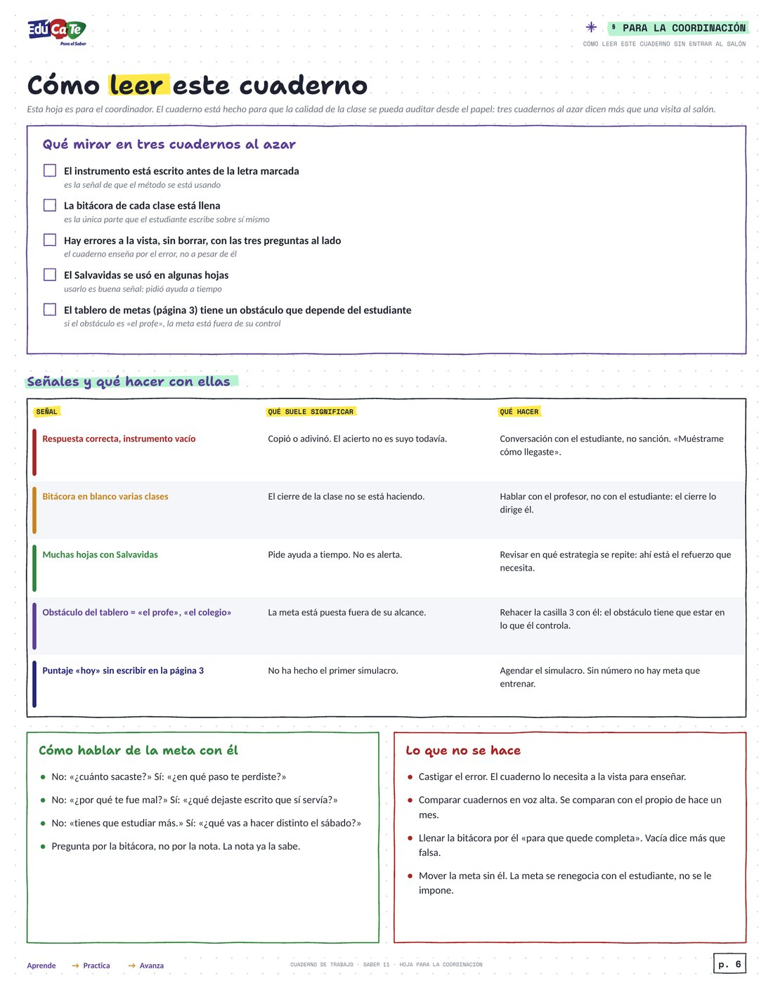

::: {.texto-lado}
**Qué se mira en tres cuadernos al azar**

1. El instrumento está escrito **antes** de la letra marcada: es la señal de que el método se está usando.
2. La bitácora de cada clase está llena.
3. Hay errores a la vista, sin borrar, con las tres preguntas al lado («¿qué entendí mal?», «¿en qué paso me desvié?», «¿qué hago distinto?»).
4. El salvavidas se usó en algunas hojas: usarlo es buena señal.
5. El tablero de metas (página 3) tiene un obstáculo que depende del estudiante.

**Señales y qué hacer.** Una respuesta correcta con el instrumento vacío es una conversación con el estudiante. Una bitácora en blanco varias clases seguidas es una conversación con el profesor: el cierre lo dirige él.
:::
:::

El planeador repite esta lista al profesor al comienzo de cada área, para que la marque él mismo al terminar el sábado. Así el profesor sabe de antemano qué va a mirar la coordinación.

# Anatomía de una hoja

Todas las páginas de taller del cuaderno, en las siete áreas, tienen las mismas partes. El estudiante las aprende una vez, en la página 4 («Así se lee una hoja»), y desde ahí la forma no le cuesta: toda su atención va a la pregunta.

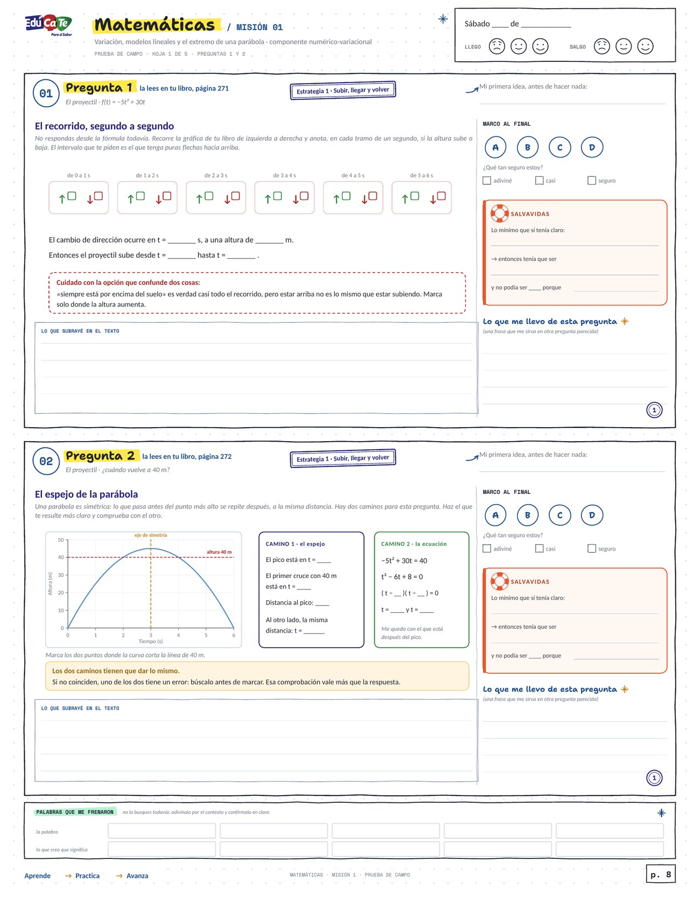{.media}

## La tarjeta de una pregunta

::: {.anatomia}
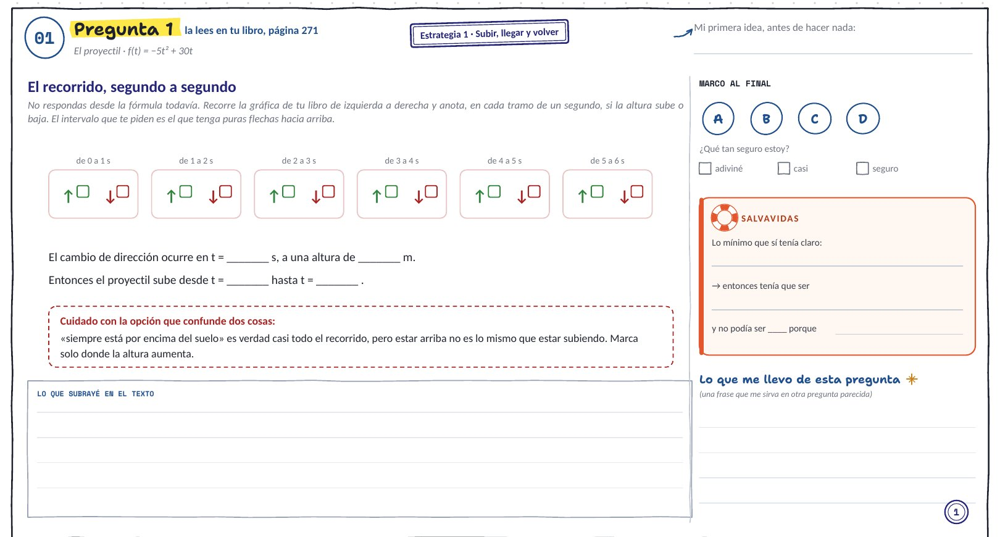

[1]{.m style="left:34.6%;top:5.5%"}
[2]{.m style="left:21%;top:9.4%"}
[3]{.m style="left:58.6%;top:6%"}
[4]{.m style="left:87.7%;top:5.1%"}
[5]{.m style="left:26%;top:13.6%"}
[6]{.m style="left:79.3%;top:15.5%"}
[7]{.m style="left:95.6%;top:30%"}
[8]{.m style="left:84.3%;top:40.6%"}
[9]{.m style="left:32.4%;top:57.1%"}
[10]{.m style="left:93.5%;top:70.7%"}
[11]{.m style="left:17.6%;top:73.2%"}
:::

::: {.leyenda}
1. **El número y «la lees en tu libro, página N».** La pregunta no se reimprime: el estudiante trabaja con el libro abierto.
2. **El contexto en una línea**, para ubicar la pregunta sin copiarla.
3. **El sello de la estrategia**, con el color del área. Es el mismo nombre que dice el profesor y que aparece en pantalla.
4. **Mi primera idea, antes de hacer nada.** Lo que el estudiante cree antes de razonar. Al final la compara con lo que resolvió.
5. **El instrumento de pensamiento**, con su título y su instrucción: el espacio donde se razona (ver abajo).
6. **Marco al final.** Las opciones van en círculos iguales: la letra es lo último que se escribe.
7. **¿Qué tan seguro estoy?** Adiviné, casi, seguro. Separa el acierto con razones del acierto con suerte.
8. **El salvavidas**, para cuando se bloquea.
9. **El aviso de la trampa** («Cuidado con la opción que…»), cuando la pregunta tiene una opción que confunde.
10. **Lo que me llevo de esta pregunta:** una frase que sirva en otra pregunta parecida.
11. **Lo que subrayé en el texto**, o lo que observé, según el área.
:::

## Mi primera idea

Antes de tocar los datos, el estudiante escribe lo que cree. No se califica. Sirve para dos cosas: le muestra al estudiante cuánto cambia su respuesta cuando razona, y le muestra al profesor qué intuiciones equivocadas trae el grupo. Es también la única casilla que se llena durante la pregunta problematizadora, cuando el resto del cuaderno sigue cerrado.

## El instrumento de pensamiento, uno por pregunta

El instrumento es el corazón de la hoja. Es un formato pequeño, diseñado para **esa** pregunta, que obliga a dar el paso que la resuelve: una fila de tramos con flechas para ver cuándo sube una gráfica, una tabla que ordena tres especies columna por columna, tres cajones para separar lo que se mueve, lo que se mide y lo que se deja quieto.

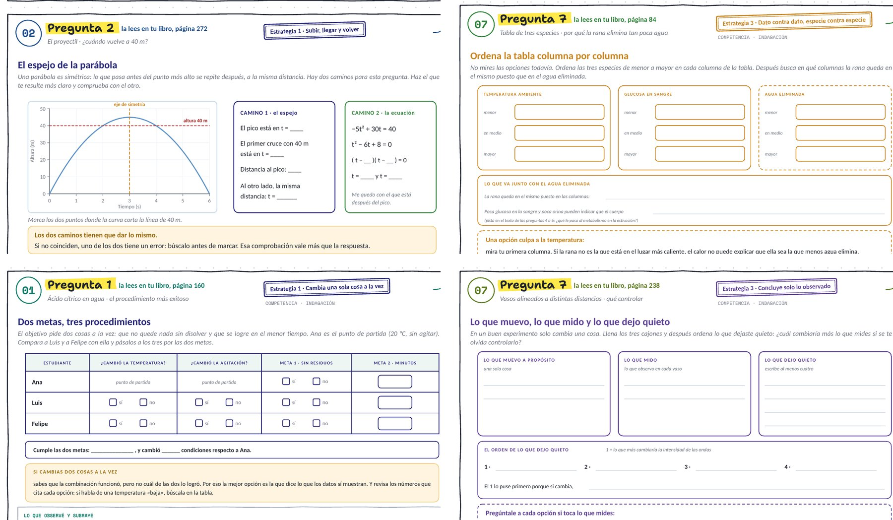

**Regla: cada pregunta lleva su propio instrumento.** No se repite la misma plantilla de flechas y cuadritos. Si dos preguntas se ven iguales, está mal hecho. Las razones:

- **Una plantilla única se llena en automático.** A la tercera vez el estudiante copia la forma sin pensar. Un instrumento nuevo lo obliga a leer la instrucción y a preguntarse qué le están pidiendo.
- **Cada pregunta del Saber 11 pide un movimiento distinto.** Comparar contra un control, seguir una cadena de causas, separar lo que alguien dice de lo que busca. El instrumento le da forma física a ese movimiento.
- **Un instrumento genérico se vuelve trámite.** Y un trámite no se puede auditar: se llena igual se haya pensado o no.

Hoy el cuaderno tiene **655 instrumentos registrados**, uno por pregunta (en `tablero/instrumentos.csv`), y un verificador comprueba que no haya dos con el mismo título. Cada portada de área presenta además el **instrumento del área**, que es la idea madre de la que salen los de cada pregunta: la cuadrícula de trabajo en Matemáticas, el mapa de actores en Sociales, la pista en el contexto en Inglés.

**Ningún instrumento puede delatar la respuesta.** Ni con un borde más grueso en la opción correcta, ni con mayúsculas en las incorrectas, ni haciendo más larga la opción buena. Se puede resaltar el trozo del texto por el que se pregunta; no se puede resaltar una de las alternativas entre las que el estudiante decide, porque el ojo va ahí antes de leer.

## Marco al final y qué tan seguro estoy

La letra se marca después del instrumento, en círculos todos iguales. Al lado, el estudiante dice qué tan seguro está: **adiviné, casi o seguro**. En la devolución, un «seguro» equivocado señala un concepto mal aprendido; un «adiviné» acertado, un acierto que no se va a repetir en el examen.

## El salvavidas

El salvavidas es la ruta mínima para desbloquearse. Tiene tres renglones: **«Lo mínimo que sí tenía claro»**, **«→ entonces tenía que ser…»** y **«y no podía ser \_\_\_ porque…»**. Enseña a avanzar con lo poco que se sabe y a descartar con una razón, que es lo que salva una pregunta difícil en el examen.

Es igual en las siete áreas, por decisión de Nelson González: fondo claro, borde y flotador coral, renglones grises. El estudiante lo llena con lápiz, así que nunca va sobre un fondo oscuro. En la apertura el cuaderno lo dice de frente: «Pedirlo no resta; no pedirlo cuando lo necesitas, sí».

## Lo que me llevo

Al pie de la columna derecha, una frase **que sirva en otra pregunta parecida**. No es un resumen de la pregunta; es la regla que el estudiante se lleva para la próxima. En las preguntas de entrenamiento esta casilla cambia por **«¿En qué se parece a lo del taller?»**, porque ahí se trata de reconocer la estrategia en una pregunta nueva.

## La franja de vocabulario: «Palabras que me frenaron»

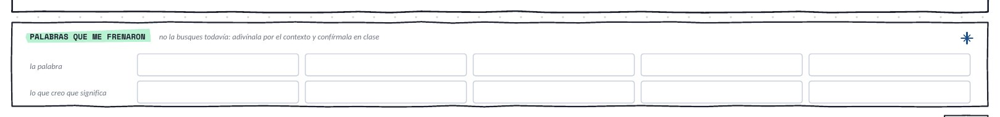

Muchas páginas de taller llevan al pie una franja para las palabras que frenaron al estudiante. La instrucción es deliberada: **no la busques todavía; adivínala por el contexto y confírmala en clase.** Adivinar por el contexto es exactamente lo que el examen exige. En el cierre de la clase, el profesor pide que cada uno escriba ahí el concepto del día.

## La fecha y las caritas

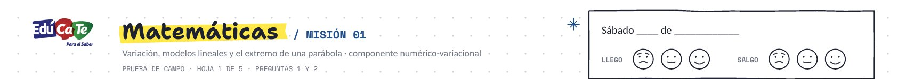

Cada página empieza con **«Sábado \_\_\_ de \_\_\_»** y dos filas de caritas: **cómo llego** y **cómo salgo**. Son la parte de diario personal del cuaderno: el estudiante registra su estado al empezar y al terminar, y con las semanas ve que cansado no es lo mismo que perdido. La cabecera dice además el área, la misión, el componente del ICFES que se entrena y qué preguntas trae la hoja.

## Por qué un diario y no un taller

El cuaderno está pensado para sentirse como **un diario personal**, no como un taller genérico: la fecha, las caritas, la primera idea, lo que me llevo, la portada de cada área con «Mis ocho clases» (fecha, cómo llegué, cómo salí, una cosa que aprendí). Un taller se entrega y se olvida. Un diario se vuelve a leer, y releer la propia letra es lo que hace que el método se quede.

## Otras piezas que aparecen en algunas tarjetas

- **El sello «Alto · aquí entra el profe».** Marca las preguntas donde el estudiante no puede seguir sin que el profesor explique un concepto (por ejemplo, qué es una EPS o qué fue la Constituyente de 1991). El planeador trae ese concepto explicado en dos minutos.
- **Corrección EDUCATE.** Cuando el libro trae un error que impide responder, la tarjeta lo dice y lo corrige: «el libro trae un error: así lo arreglamos», con una casilla «Lo corregí en mi libro». El error queda registrado para informar a la editorial.
- **Los recuadros de apoyo.** Notas breves que explican una idea necesaria para la pregunta (por ejemplo, qué es un cognado en Inglés) sin dar la respuesta.

# Estrategias y subestrategias

## Qué es una estrategia en este método

Una estrategia es **el movimiento mental que resuelve un tipo de pregunta, dicho con palabras de estudiante.** No es un tema («la parábola», «la célula») ni una competencia del ICFES («argumentación»): es lo que hay que hacer con la cabeza. Por eso los nombres son frases cortas que se pueden decir en voz alta en el salón:

| Área | Algunas estrategias, tal como aparecen en el cuaderno |
|--------|----------------------------|
| Matemáticas | Subir, llegar y volver · Lo fijo y lo que crece · Juzgar el procedimiento · Hasta dónde llega el dato |
| Lectura Crítica | La palabra exacta · Lo que no se dice · Qué se cae si quito esto · Dice una cosa y hace la contraria |
| Sociales y Ciudadanas | Quién dice qué y por qué · Quién gana y quién paga · Eficaz no es lo mismo que legítimo |
| Biología | Comparar contra el que no cambió · Sigue la red: quién depende de quién · Lo que alcanza a explicar |
| Química | Cambia una sola cosa a la vez · La propiedad que la delata · Los átomos no se pierden: se cuentan |
| Física | Las fuerzas, una por una · El experimento justo · ¿Alcanzan los datos para esa conclusión? |
| Inglés | El verbo delata la palabra · Es verdad, pero no responde · La palabra de al lado manda la forma |

## Cómo se construyen

Cada misión tiene **cuatro estrategias**; cada área, **veinticuatro**. Se construyen siempre en el mismo orden:

1. **Se resuelven las diez preguntas del libro una por una**, sin solucionario. De ahí sale la clave verificada y, sobre todo, el paso que de verdad decide cada pregunta.
2. **Se agrupan las preguntas por ese paso.** Las que se resuelven con el mismo movimiento comparten estrategia. Una misión suele dar cuatro grupos.
3. **Se nombra cada grupo con una frase de estudiante**, que diga qué hacer y no de qué trata. «Cambia una sola cosa a la vez» sirve en el examen; «diseño experimental» no.
4. **Se le asigna la competencia del ICFES** que entrena (la clasificación es de EDUCATE; los especialistas deben revisarla, sección 11).
5. **Se diseña el instrumento de cada pregunta** a partir de su estrategia, distinto para cada una.
6. **Se escogen las cuatro preguntas de entrenamiento** de modo que entrenen esas estrategias en una pregunta nueva.
7. **Se diseña una dinámica por estrategia** para el planeador, que ensaye con el cuerpo el mismo movimiento (sección 8).

Al final del área, si el estudiante puede nombrar las veinticuatro estrategias y decir para qué sirve cada una, el área cumplió, aunque falle preguntas. Eso dice el planeador al profesor.

## El caso de Inglés

Inglés funciona distinto por dos decisiones de Nelson (7 de noviembre):

- **Trabaja todas las preguntas del libro**: 127 en total (Misión 1: 21; Misión 2: 10; Misión 3: 40; Misión 4: 16; Misión 5: 16; Misión 6: 24), una tarjeta por pregunta, cada una con su instrumento propio. Por eso el área ocupa 77 páginas más sus 6 de simulacro, en lugar de 43 más 6.
- **Cada misión es una parte del examen de Inglés.** La Misión 1 entrena las partes 1 y 2 (avisos y vocabulario); la 2, la parte 3 (conversaciones); la 3, la parte 4 (texto con espacios); la 4 y la 5, las partes 5 y 6 (lectura literal e inferencial); la 6, la parte 7.

Así, cada parte tiene **una estrategia general** (por ejemplo, «La pista que decide» o «Contéstale a la persona, no a la palabra») y **cuatro subestrategias**, que son las que aparecen en el sello de cada tarjeta: «Subestrategia 1 · El verbo delata la palabra». Nelson rechazó un formato anterior en tablas porque «se ven como tablas»: cada pregunta de Inglés tiene, como en las otras áreas, su instrumento.

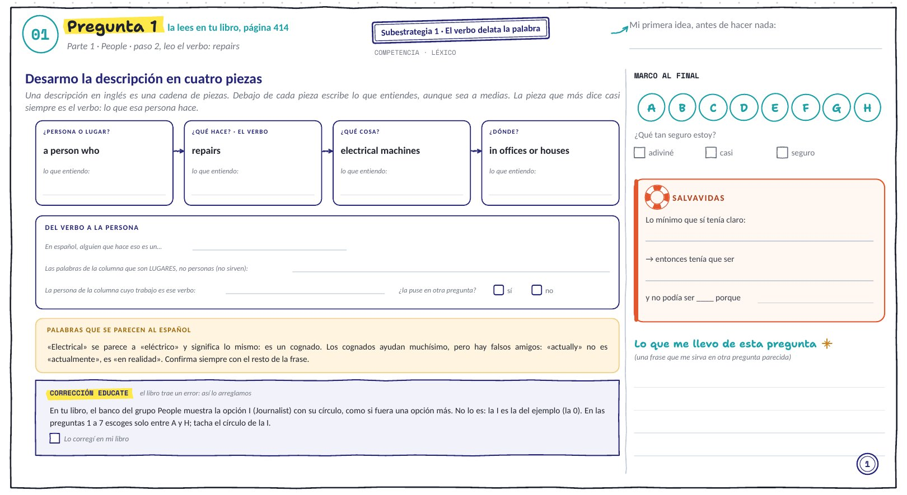

Como 127 preguntas no caben en seis clases, el planeador de Inglés reparte cada misión en tres destinos: **en clase**, diez tarjetas representativas; **en el reto del corte**, un texto o un grupo completo en relevo por equipos; **en la casa**, el resto, que se revisa con una **ronda de claves** de cinco minutos al comenzar la clase siguiente (cada uno marca con otro color lo que falló y escribe al lado la pista que no vio).

# El entrenamiento Saber 11

## Cuatro preguntas por misión

Cada misión cierra con cuatro preguntas del formato del Saber 11, dos en la página 3 y dos en la página 7 de la misión. Se resuelven en la fase de **evaluación individual**: en silencio, con reloj y sin ayuda del profesor. Es el momento que produce el dato de seguimiento de la clase: el profesor no corrige, anota quién llena el instrumento y quién va directo a las opciones.

Las preguntas de entrenamiento también llevan instrumento, mi primera idea, salvavidas y marco al final. Lo que cambia es la casilla del cierre: **«¿En qué se parece a lo del taller?»** El objetivo es que el estudiante reconozca la estrategia de la misión en una pregunta que no ha visto.

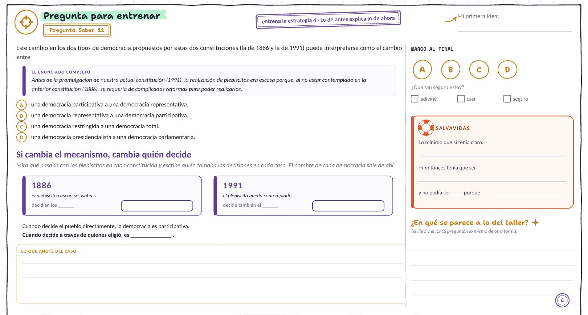

## El membrete: «Pregunta Saber 11»

Cada pregunta de entrenamiento lleva el título **«Pregunta para entrenar»** y el membrete **«Pregunta Saber 11»**: sin año, sin la palabra «oficial» y sin la palabra «ICFES». Así quedó por decisión de Nelson González (10 de noviembre), después de dos ajustes anteriores. Las razones:

- **Nunca se inventa el año ni el cuadernillo de una pregunta.** Para muchas preguntas del banco no hay certeza del año ni de la aplicación en que salieron. Un membrete con un año que no se puede probar es un dato falso impreso en material escolar.
- **No todas las preguntas vienen de cuadernillos del ICFES.** Algunas salen del compilado ASED, cuya propia presentación dice que sus preguntas fueron concebidas por la Corporación ASED. Decir «oficial» o «ICFES» sobre ellas sería falso. Por eso, en ningún lugar que vea el estudiante se dice «preguntas reales del ICFES».
- **Lo que el membrete sí promete es cierto:** la pregunta tiene la forma y el nivel del Saber 11. Así se lo explica el cuaderno al estudiante en la página 4.

La procedencia verificada de cada pregunta no se pierde: queda en la matriz del proyecto (`tablero/icfes.csv`, columna «fuente»). En la guía del profesor, una pregunta del ASED dice «Fuente: compilado ASED (no es del ICFES)».

## Cómo se verifican las claves: resolviéndolas

**Toda clave se verifica resolviendo la pregunta, nunca copiándola de un solucionario.** Los solucionarios se equivocan, y una clave errada en el cuaderno enseña lo contrario de lo que se quiere. Además, cuando un documento muestra la clave al lado de la pregunta, se comprueba que esté al lado de **esa** pregunta: un verificador automático (`verifica_claves.py`) lo revisa en todo el material.

Y una regla de Nelson para escoger: **una pregunta con cualquier falla no se usa.** Si tiene una errata, un dato que no cuadra o dos opciones defendibles, se reemplaza. Las fuentes aceptadas son los cuadernillos liberados en el sitio del ICFES y el Simulacro II 2023, que Nelson confirmó como preguntas del ICFES. Antes de escoger preguntas nuevas se revisa la matriz para no repetir.

# El simulacro y la devolución

## Clase 7: el simulacro de EDUCATE

El simulacro no está en el cuaderno. EDUCATE escoge la prueba (un cuadernillo o una prueba digital) y la aplica en condiciones de examen: puestos separados, sin celular, en silencio y de corrido. No repite las 24 preguntas de entrenamiento del área, que el estudiante ya resolvió con instrumento.

| Tramo | Qué pasa |
|----|------------------------|
| 0–10 min | Condiciones de examen. Hora de inicio y de cierre en el tablero. Cuaderno cerrado. |
| 10–100 min | La prueba, de corrido. Las respuestas, solo en la hoja de respuestas. |
| 100–120 min | Se recogen las hojas. Cada estudiante abre su primera hoja de simulacro y anota el número de las tres preguntas que quiere socializar. |

En la semana, el profesor cuenta cuántos fallaron cada pregunta y los aciertos por competencia. Ese conteo decide el refuerzo; no es una nota. Todo reclamo sobre una pregunta del simulacro (un dato que no cuadra, dos opciones posibles) se anota y va al registro de hallazgos; no se discute durante la prueba.

## Clase 8: la socialización en las hojas de simulacro

Cada estudiante trabaja **seis preguntas** del simulacro: **tres que escoge él** (las que anotó al final de la clase 7) y **tres que asigna el profesor** (las más falladas por el grupo). Las seis fases de la clase se mantienen: el profesor modela la más fallada en el tablero, cada uno llena las que escogió, la segunda asignada se trabaja en equipo con una dinámica y la tercera, en silencio, es el dato de seguimiento.

Cada área tiene al final sus hojas de simulacro: **10 páginas (30 preguntas)** en Matemáticas, Lectura Crítica y Sociales; **6 páginas (18 preguntas)** en Biología, Química, Física e Inglés. Un simulacro usa una hoja (dos páginas, seis preguntas); el resto sirve para simulacros siguientes o para reparar preguntas en casa.

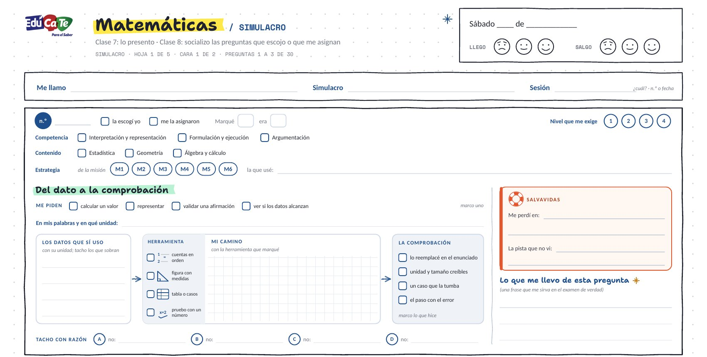

## Por qué la hoja de simulacro es así

Las hojas de simulacro tienen que servir para **cualquier** pregunta del área, no para una conocida. La primera versión dibujaba en cada área un solo tipo de pregunta y, al ponerla frente a **181 preguntas reales** de las siete áreas (cuadernillos liberados, pruebas de campo del libro y preguntas ya usadas), solo servía bien para una de cada cinco. La versión aprobada (10 de noviembre) cambia de enfoque: **le pide al estudiante que reconozca qué tipo de tarea es** y le da herramientas para trabajarla. Reconocer la tarea es, además, la primera habilidad que mide el examen.

Cada esquema tiene las mismas piezas en las siete áreas:

1. **El membrete de la pregunta:** número, si la escogió o se la asignaron, qué marcó y cuál era, el nivel que le exige, la competencia, el componente y la estrategia de la misión con que la entrenó.
2. **Me piden · marco uno:** cuatro tipos de tarea del área, en palabras de estudiante (en Matemáticas: calcular un valor, representar, validar una afirmación, ver si los datos alcanzan).
3. **Una segunda línea propia del área:** la pregunta en mis palabras, la escala, el nivel de la química o la predicción antes de mirar.
4. **Tres piezas en fila:** lo que uso → mi espacio para razonar → la pieza que cierra el razonamiento del área (la comprobación en Matemáticas, las trampas en Lectura Crítica, la idea clave en Sociales, la ley que manda en Física).
5. **La caja de herramientas:** cuatro mini formatos del área con su dibujo; el estudiante marca el que usó y lo dibuja en el espacio libre.
6. **Tacho con razón:** una razón por cada opción descartada.
7. **El salvavidas** («me perdí en», «la pista que no vi») y **lo que me llevo**.

Un esquema con la opción marcada y el resto en blanco no cuenta como socializado: es la misma regla del taller.

# El planeador del docente

Cada área tiene un planeador de **24 hojas**. Su función es una: decirle al profesor qué hacer con el libro y con el cuaderno en cada uno de los 120 minutos, y dónde termina lo fijo y empieza su aporte. No le pide ser experto en el área.

| Hojas | Qué trae |
|----|----------------------------|
| 1 | Para qué existe el documento, el instrumento del área, el área en números, las competencias del ICFES, avisos antes de empezar, «Si el área no es tu fuerte» y lo que revisa la coordinación. |
| 2 | Las ocho clases de un vistazo y las 24 estrategias del área. |
| 3 y 4 | Los 120 minutos: las seis fases con su objetivo específico, qué hace el docente, cómo lo hace y su espacio de aporte. |
| 5 a 16 | Dos hojas por clase de contenido: estrategias, conceptos que hay que instalar, sellos, las diez preguntas con su instrumento y su clave, lo que hay que saber del libro, el sábado minuto a minuto, los conceptos para explicar en dos minutos, las cuatro preguntas de entrenamiento y el registro del docente. |
| 17 | Clases 7 y 8: el simulacro y su socialización, pieza por pieza. |
| 18 a 23 | El banco de dinámicas: una hoja por misión, con cuatro dinámicas y el reto del corte. |
| 24 | El cierre del área: todos los avisos del libro y lo que el profesor tiene que devolver. |

::: {.dos}
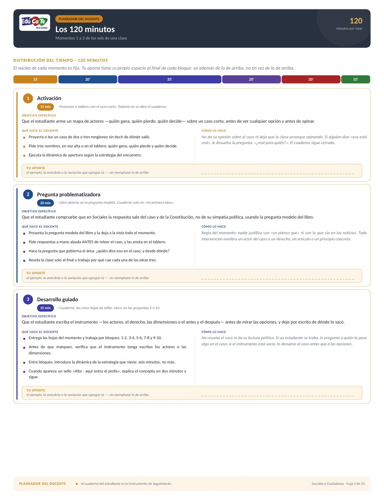

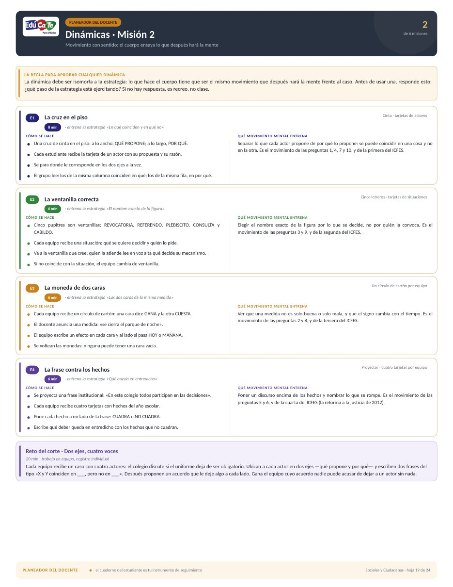
:::

## Lo fijo y «TU APORTE»

En cada fase, el planeador da tres cosas fijas: el **objetivo específico**, **qué hace el docente** y **cómo lo hace** (incluido lo que no hace: no dicta la definición, no da su opinión sobre el caso, no revela la clave antes de tiempo). Debajo hay un espacio rotulado **«TU APORTE»**: el ejemplo, la anécdota o la variación que agrega el profesor, **declarado y acotado, sin reemplazar lo de arriba.**

Esta es la forma en que el método respeta al profesor sin depender de él. Su experiencia cabe y se nota, pero va además del núcleo, no en lugar de él. Un sábado con un profesor brillante y un sábado con un reemplazo de última hora comparten el mismo núcleo.

## Las dinámicas: isomorfas a la estrategia

Cada misión trae cuatro dinámicas, una por estrategia, de 6 a 8 minutos. La regla para aprobar cualquiera es la misma en todas las áreas:

::: {.cita}
La dinámica debe ser isomorfa a la estrategia: lo que hace el cuerpo tiene que ser el mismo movimiento que después hará la mente frente a la pregunta. Si no puedes decir qué paso de la estrategia ejercita, es recreo, no clase.
:::

Un ejemplo del planeador de Sociales. La estrategia «Quién gana y quién paga» se entrena con **«La balanza humana»**: un lado del salón es GANA y el otro es PAGA; el profesor lee una medida y reparte tarjetas con sus efectos; cada estudiante camina al lado que le toca y dice a quién afecta; si un lado queda vacío, el análisis está incompleto. El cuerpo hace exactamente lo que la mente tendrá que hacer frente a la pregunta: repartir los efectos entre los dos platillos. Por eso cada dinámica del planeador trae una columna «qué movimiento mental entrena» y dice a qué preguntas del libro y de entrenamiento corresponde.

## El reto del corte

Cada misión trae un **reto del corte** de 20 minutos para la fase de reto en equipo: una situación nueva que obliga a usar las cuatro estrategias juntas. Los equipos son de tres; el equipo discute, pero **cada integrante escribe en su propia tarjeta**, y cada uno llega con su instrumento ya diligenciado individualmente. La defensa no acepta «es que así es»: se nombra el dato, el actor o el renglón que respalda la respuesta. El registro individual es lo que hace que el trabajo en equipo no esconda a nadie.

## «Si el área no es tu fuerte»

Un instituto que trabaja los sábados no siempre tiene al especialista de cada área. El planeador lo asume. En cada clase hay un recuadro **«Si [el área] no es tu fuerte»** con los cuatro conceptos que el profesor tiene que poder explicar en dos minutos y sin jerga, y los sellos del cuaderno le dicen en qué preguntas tiene que entrar. Lo demás lo sostiene el instrumento.

La instrucción para cuando no se sabe algo es explícita: no inventar. «No lo sé; vamos a ver qué dice el texto», anotarlo en el registro y traerlo resuelto la próxima clase. Si un estudiante sabe más que el profesor, se le pide que explique y que señale en el texto de dónde lo saca.

## Lo que hay que saber del libro

El planeador no le esconde al profesor los problemas del libro. Cada clase trae **«Lo que tienes que saber del libro antes de entrar»**: claves que chocan con el enunciado, datos desactualizados, opciones que se delatan solas, temas sensibles. Cada aviso dice qué pasa y qué hace el profesor. Ninguno se le oculta al estudiante: si lo detecta y lo escribe, aprendió más que el que marcó la opción esperada. La hoja 24 los reúne todos para el repaso y pide al profesor que devuelva los avisos nuevos que encuentre.

## El registro del docente

Después de cada clase, el mismo sábado, el profesor llena un registro breve que el estudiante no ve: qué concepto hubo que explicar dos veces y con qué ejemplo funcionó, a quién hay que volver la próxima clase (con nombres, no «algunos»), qué cuaderno quedó con el instrumento vacío aunque haya acertado. Al terminar el área devuelve los seis registros, el conteo por competencia del simulacro y los avisos nuevos.

# Las guías proyectables

Cada clase tiene su guía para proyectar: **56 en total**. Es un archivo único que se abre con doble clic en cualquier computador, **funciona sin internet** y no necesita instalar nada.

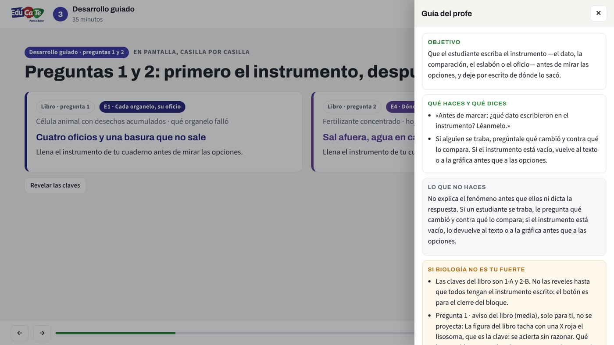

## Cómo está armada

Una clase de contenido tiene **19 diapositivas**, en el orden de las seis fases:

portada · reglas de la clase · activación · dinámica de la estrategia 1 · pregunta modelo con conteo de manos · cinco bloques de dos preguntas, con las dinámicas de las estrategias 2, 3 y 4 intercaladas · reto del corte · las cuatro preguntas de entrenamiento con su texto completo · cierre («¿En qué se parecía la pregunta Saber 11 a la de tu libro?»).

La barra superior muestra siempre **la fase actual** (un círculo de color con su número) y un **cronómetro que se reinicia solo al cambiar de fase**, con el tiempo aprobado para esa fase.

::: {.dos}
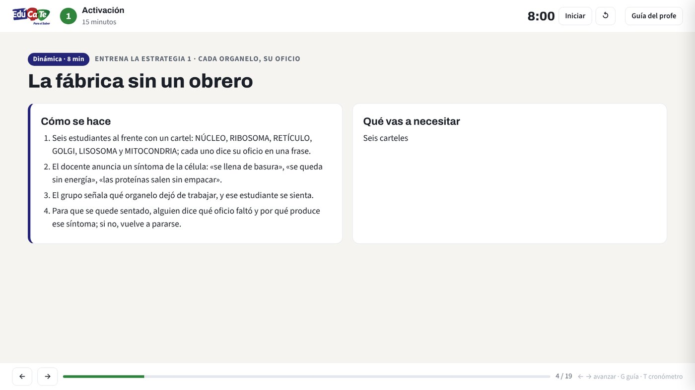

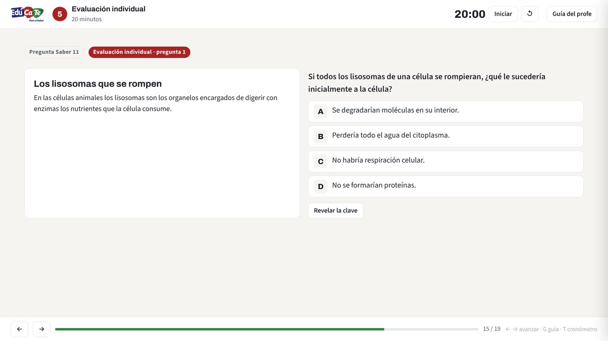
:::

## Las teclas

| Tecla | Qué hace |
|--------|------------------------|
| ← → o espacio | Avanza o retrocede una diapositiva |
| Inicio / Fin | Va a la primera o a la última |
| G | Abre o cierra la guía del profe |
| T | Inicia o detiene el cronómetro |
| Esc | Cierra la guía del profe |

## La guía del profe

Con la tecla G se abre un panel lateral que solo debería ver el profesor (conviene usar la pantalla extendida o abrirlo cuando el proyector esté en pausa). Trae, para la diapositiva en curso: **el objetivo**, **qué hace y qué dice** (con frases literales), **lo que no hace** y **«Si [el área] no es tu fuerte»**, con las claves de las preguntas y los avisos del libro que son solo para él.

## Las claves solo con «Revelar»

**Ninguna clave aparece en pantalla antes de que el profesor la revele.** Cada bloque y cada pregunta de entrenamiento tienen un botón «Revelar la clave» (o «Revelar las claves»). La guía dice cuándo usarlo: al cierre del bloque, cuando todos tengan el instrumento escrito. Un verificador recorre todas las guías y comprueba, entre otras cosas, que ninguna clave sea visible al llegar a una diapositiva.

## Las guías de las clases 7 y 8

La guía de la **clase 7** no proyecta ninguna pregunta ni clave: muestra las condiciones de examen y un **cronómetro grande de 90 minutos** que no se reinicia al cambiar de diapositiva. La de la **clase 8** tiene casillas donde el profesor escribe los números de las preguntas más falladas, que reaparecen en las diapositivas siguientes para que todo el grupo las tenga a la vista.

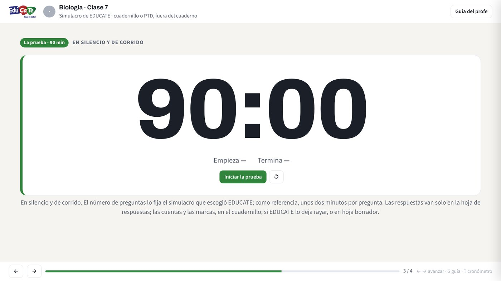{.chica}

# Lo socioemocional

El Saber 11 no se juega solo en lo que el estudiante sabe, sino en cómo se sostiene frente a una pregunta difícil. El cuaderno lo trabaja al comienzo, en cada página y al final, con un tono **juvenil y algo filosófico**: hablarle de frente, sin sermonear.

## La apertura (páginas 1 a 6)

::: {.dos}
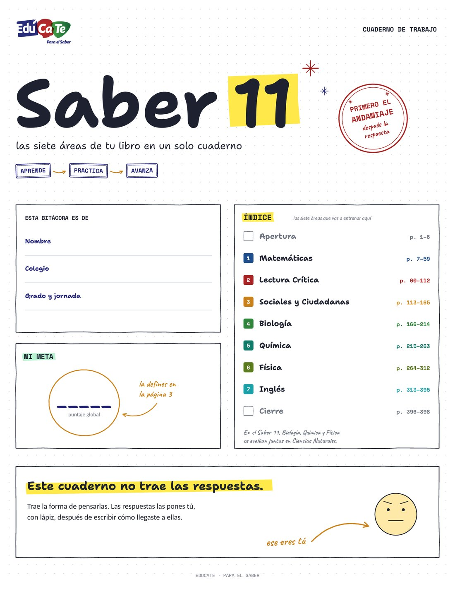

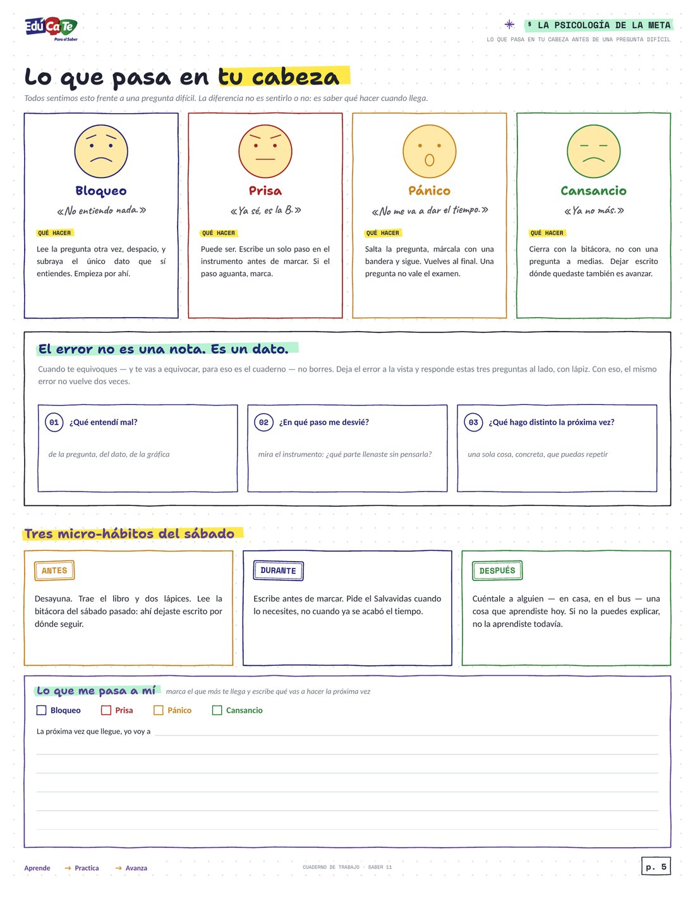
:::

- **Página 1 · Portada.** «Esta bitácora es de»: el nombre, el colegio, la meta. Y una frase: «Este cuaderno no trae las respuestas. Trae la forma de pensarlas».
- **Página 2 · Antes de la primera pregunta.** Por qué existe el cuaderno, contado al estudiante: «El puntaje de esta prueba no dice quién eres; dice qué puertas se abren sin que tengas que pedir permiso». Las **cuatro reglas que no cambian**: primero el andamiaje; el error escrito vale más que el acierto callado; nadie resuelve por ti, nadie te deja solo; la bitácora se llena siempre.
- **Página 3 · Ponle un número a tu meta.** La escala del puntaje, una cuenta de cuántos puntos por semana le faltan y **«Mi tablero de metas»** en cuatro casillas: deseo, resultado, obstáculo y plan. Se basa en la investigación de la psicóloga Gabriele Oettingen (el método WOOP): visualizar la meta no basta; la meta se mueve cuando el estudiante nombra **su** obstáculo y decide qué hará cuando aparezca («si… entonces…»). El obstáculo tiene que estar en él, no en el profesor ni en el colegio.
- **Página 4 · Así se lee una hoja.** La anatomía de la sección 4, explicada al estudiante, y cómo sube de nivel según los niveles de desempeño del ICFES.
- **Página 5 · Lo que pasa en tu cabeza.** Cuatro estados frente a una pregunta difícil (bloqueo, prisa, pánico, cansancio), cada uno con qué hacer; «El error no es una nota. Es un dato», con tres preguntas para cada error; tres micro hábitos del sábado.
- **Página 6 · Para la coordinación.** Cómo leer el cuaderno sin entrar al salón, y **cómo hablar de la meta con el estudiante**: no «¿cuánto sacaste?» sino «¿en qué paso te perdiste?»; no «tienes que estudiar más» sino «¿qué vas a hacer distinto el sábado?».

## En cada página y en cada área

Lo socioemocional no se queda en la apertura. Cada página pregunta cómo llega y cómo sale el estudiante. Cada portada de área registra las ocho clases (fecha, cómo llegué, cómo salí, una cosa que aprendí) y los puntajes del área frente a la meta. El salvavidas convierte el bloqueo en un procedimiento. Inglés, el área donde más pesa el miedo al error, abre diciéndolo en su propio idioma: *Mistakes are proof that you are trying*.

## El cierre (páginas 396 a 398)

::: {.dos}
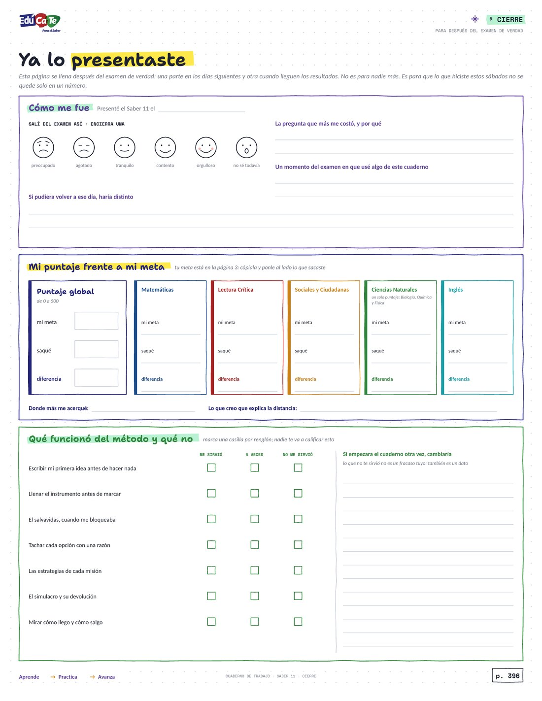

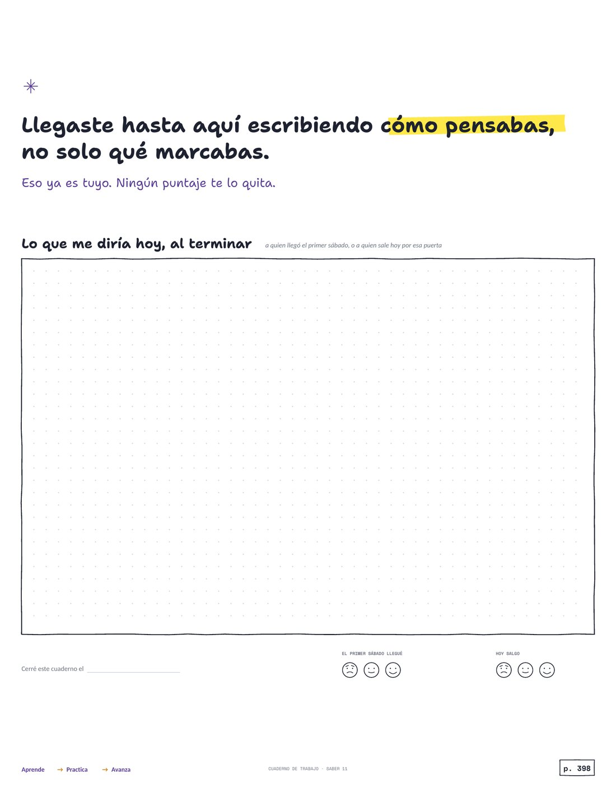
:::

- **Página 396 · Ya lo presentaste.** Se llena después del examen de verdad: cómo salí, mi puntaje frente a mi meta, y qué funcionó del método y qué no, casilla por casilla. «Lo que no te sirvió no es un fracaso tuyo: también es un dato.»
- **Página 397 · Lo que me llevo.** Una forma de pensar que el estudiante se lleva para la universidad o el trabajo, dónde la va a necesitar, y una **carta a quien empieza este cuaderno el próximo año**.
- **Página 398 · El mensaje final.** «Llegaste hasta aquí escribiendo cómo pensabas, no solo qué marcabas. Eso ya es tuyo. Ningún puntaje te lo quita.» Y un espacio para que el estudiante escriba lo que se diría hoy.

La página 396 cumple además una función para EDUCATE: si se recogen, los «qué funcionó del método y qué no» son la primera opinión estructurada de los estudiantes sobre el método.

# Control de calidad

El material se produce con un sistema de controles que existe porque cada error encontrado enseñó algo. Ninguno reemplaza la revisión humana.

## Los verificadores

Antes de entregar cualquier pieza se corren estos verificadores:

| Qué revisa | Verificador |
|------------------------|--------|
| Que cada instrumento quepa en su espacio, sin pasarse de alto ni de ancho; que ningún texto vaya en el gris de las líneas (no se lee en papel); que los rótulos tengan su ancho real | `verifica_cajas.py` |
| Que ningún instrumento delate la respuesta (bordes, tipografía) | `verifica_pistas.py` |
| Que no haya dos instrumentos con el mismo título | `extrae_instrumentos.py` |
| Que el pie esté en todas las páginas del PDF (detecta archivos recortados) | `render.verifica()` |
| Que nada se desborde en el planeador | `verifica_plan.py` |
| Que cada clave esté al lado de su pregunta | `verifica_claves.py` |
| Que las guías no tengan errores, no muestren claves antes de revelarlas, no se salgan de ancho y que las clases 7 y 8 funcionen | `verifica_guias.js` |

## La revisión visual

Los desbordes de texto no se ven en el código. **Cada página se rasteriza y se mira** antes de entregarla, y se vuelve a mirar después de cada corrección. Varios errores reales se encontraron así y no de otra forma: una franja que tapaba una tarjeta, un rótulo montado sobre la columna vecina, unas guías que mostraban las claves del taller.

## El registro de hallazgos

**Todo hallazgo se registra, aunque no sea un error.** Va en `tablero/hallazgos.csv`, con su ubicación, qué pasa, su efecto, su severidad (alta, media, baja o «Atención», para lo que no requiere corrección pero hay que saber) y su estado (reportado, registrado, corregido o «corregido en el cuaderno · informar a la editorial»). Hoy el registro tiene **346 entradas**. De ahí salen los avisos del planeador y el informe de hallazgos para la editorial.

## Reglas de diseño que también son control

Algunas reglas de forma existen para que el cuaderno se lea bien impreso y no parezca hecho en serie:

- **Nada de líneas horizontales decorativas** bajo los títulos, en los encabezados o en las portadas. Se notan como material generado en automático. Los acentos verticales sí se permiten.
- **Texto justificado**, medido con la fuente real; nunca contando caracteres.
- **«EDUCATE» siempre en mayúsculas sostenidas.**
- Cada área tiene **su color**, que es su personalidad: Matemáticas azul, Lectura Crítica rojo, Sociales oro, Biología verde hoja, Química verde esmeralda, Física verde oliva, Inglés turquesa.

## La revisión de especialistas

La propuesta aprobada compromete que cada área pase por la revisión de un especialista antes de la entrega final (Matemáticas y Física las revisa directamente Nelson González). Esa revisión **todavía no se ha hecho**. Está preparada la lista de lo que cada especialista debe mirar, que se concentra en lo que no viene del libro ni del ICFES sino que se escribió para el cuaderno: las claves del taller con su procedimiento (el libro no trae claves), las explicaciones de «Si el área no es tu fuerte», los conceptos de los sellos, la competencia asignada a cada estrategia, los datos citados en dinámicas y retos, las «Correcciones EDUCATE» de Inglés, y los textos nuevos de la apertura y el cierre. Se estima una a dos horas por área.

Antes de esta revisión, el libro fuente ya había pasado por seis docentes revisores externos, cuyos 120 hallazgos están cruzados con los del proyecto.

# Qué datos producirá el método

Como se dijo al comienzo, el método no tiene todavía resultados medidos. Lo que sí tiene es un diseño que produce datos desde el primer sábado, sin instrumentos adicionales:

- **Por clase:** la evaluación individual (cuatro preguntas en silencio, con el registro de quién llena el instrumento) y el registro del docente.
- **Por área:** los aciertos por competencia en el simulacro de la clase 7, y las preguntas más falladas.
- **Por estudiante:** el puntaje de cada simulacro frente a su meta (portada del área y página 3), las caritas de llegada y salida, y el uso del salvavidas.
- **Al final:** la página 396, con la opinión del estudiante sobre cada pieza del método.

Para poder decir algún día cuánto mejora el método, conviene definir antes de empezar qué se va a comparar (por ejemplo, el primer simulacro de cada área contra el último, o grupos que usaron el cuaderno contra registros anteriores del instituto) y cómo se van a recoger esos datos. Esa definición le corresponde a EDUCATE.

# Decisiones abiertas

Estas decisiones no están en manos del equipo que construyó el material:

| Decisión | Quién | Por qué importa |
|----------------|--------|------------------------|
| Aprobar la ampliación: de 6 a 7 áreas, de unas 270 a 398 páginas, de 48 a 56 clases | Gerente General | Cambia el costo de impresión y el tiempo. Viene de seguir el libro (Biología y Química por separado), de trabajar todas las preguntas de Inglés y de las hojas de simulacro. |
| Nombres de políticos colombianos vivos en preguntas del libro | Gerente General | Varias preguntas de Sociales y una de Lectura Crítica los nombran. Mientras se decide, no se agregan preguntas con nombres propios de la política y en clase se lee el argumento, no al personaje. |
| Reemplazar las 15 preguntas de entrenamiento que salen del compilado ASED | Nelson González | El ASED no es del ICFES. El membrete genérico ya no promete otra cosa, pero conviene que el banco salga de cuadernillos liberados. |
| Las 4 preguntas de entrenamiento de Inglés, Misión 5, que tienen erratas | Nelson González | La regla es que una pregunta con cualquier falla no se usa. |
| Contratar la revisión de especialistas | EDUCATE | Está comprometida en la propuesta; la lista de qué revisar está lista. |
| Informar a la editorial los errores del libro y los indicios de contenido generado por IA | Gerente General | Hay claves que no coinciden con su enunciado, repartos de claves desbalanceados y tres enlaces del libro con rastros de una herramienta de IA. |
| Unificar «momento» y «misión» en el material | Nelson González | Hoy «momento» nombra a la vez las misiones y las fases de la clase. |
| La versión de imprenta: el logo en vector, márgenes de lomo, sangrado y color | Nelson González | El cuaderno de revisión no es todavía el archivo final para la imprenta. |

# Cómo se sostiene y se amplía el sistema

La propuesta prometió un sistema que EDUCATE pueda mantener sin asesoría externa. Esto es lo que hace falta saber para hacerlo.

**La fuente de verdad son los datos, no los PDF.** La carpeta `tablero/` guarda el estado del proyecto: las misiones con sus estrategias, los 655 instrumentos, las preguntas de entrenamiento con su procedencia, los hallazgos y las decisiones. Los PDF y las guías se generan a partir del código de la carpeta `libro/`. Si algo cambia, se cambia en la fuente y se vuelve a generar; no se edita el PDF.

**Para construir una misión nueva** (por ejemplo, si cambia el libro): se resuelven las diez preguntas y se registran sus claves; se definen las cuatro estrategias y su competencia (sección 5); se diseña un instrumento distinto por pregunta y se comprueba que su título no exista; se escogen cuatro preguntas de entrenamiento verificadas resolviéndolas; se escriben las cuatro dinámicas isomorfas y el reto del corte; se corren los verificadores, se mira cada página y se registran los hallazgos.

**Para cambiar una regla**, se registra la decisión con su fecha, quién la tomó y por qué en `tablero/decisiones.csv`. Las reglas de este documento salen de ahí; una regla sin registro se pierde en la próxima revisión.

**Lo que no se cambia sin una decisión explícita:** el reparto de 15 · 20 · 35 · 20 · 20 · 10; el número de clases por área; el membrete «Pregunta Saber 11»; la regla de un instrumento por pregunta; el salvavidas único.

# Anexos {.anexos}

## Anexo A · Mapa de páginas del cuaderno

| Páginas | Sección | Cuántas |
|----|------------------------|----|
| 1–6 | Apertura | 6 |
| 7–59 | Matemáticas: portada (7), seis misiones (8–49), simulacro (50–59) | 53 |
| 60–112 | Lectura Crítica: portada (60), misiones (61–102), simulacro (103–112) | 53 |
| 113–165 | Sociales y Ciudadanas: portada (113), misiones (114–155), simulacro (156–165) | 53 |
| 166–214 | Biología: portada (166), misiones (167–208), simulacro (209–214) | 49 |
| 215–263 | Química: portada (215), misiones (216–257), simulacro (258–263) | 49 |
| 264–312 | Física: portada (264), misiones (265–306), simulacro (307–312) | 49 |
| 313–395 | Inglés: portada (313), misiones (314–389), simulacro (390–395) | 83 |
| 396–397 | Cierre post-prueba | 2 |
| 398 | Mensaje final | 1 |
| | **Total** | **398** |

En el Saber 11, Biología, Química y Física se evalúan juntas en Ciencias Naturales; el cuaderno las separa porque el libro las trae separadas. Las misiones de Inglés tienen distinto número de páginas porque trabajan todas las preguntas del libro: Misión 1, 314–326; Misión 2, 327–333; Misión 3, 334–355; Misión 4, 356–365; Misión 5, 366–375; Misión 6, 376–389.

## Anexo B · Entregables

| Entregable | Comprometido en la propuesta | Estado al 10 de noviembre |
|------------|------------|----------------|
| Cuaderno combinado | 6 áreas, unas 270 páginas | 7 áreas, 398 páginas, completo (ampliación por aprobar) |
| Planeadores del docente | 6, uno por área | 7, de 24 hojas cada uno |
| Guías de clase proyectables | 48, una por clase | 56 |
| Documento maestro de metodología | 1 | Este documento, para aprobación |
| Reporte de la revisión especializada | 1 | Pendiente: la revisión no se ha hecho |
| Informe de hallazgos del libro | (fuera de la propuesta) | Entregado; se está actualizando |

## Anexo C · Las decisiones que sostienen el método

| Decisión | Origen |
|------------------------|------------|
| El reparto de la clase: 15 · 20 · 35 · 20 · 20 · 10 | Aprobado en el piloto de Matemáticas |
| Cada pregunta con su propio instrumento | Nelson González |
| El cuaderno es un diario personal: fecha, caritas, primera idea, lo que me llevo | Nelson González |
| Nada de líneas horizontales decorativas; texto justificado; EDUCATE en mayúsculas | Nelson González |
| El instrumento no resalta la opción correcta | Corrección del 2 de noviembre |
| El cuaderno sigue al libro: Biología y Química por separado, siete áreas | Nelson González, 6 de noviembre |
| Cada área tiene su color; las tres ciencias en verdes | Nelson González, 6 de noviembre |
| Salvavidas claro y único en todas las áreas | Nelson González, 6 de noviembre |
| Inglés trabaja todas las preguntas del libro, una misión por parte del examen | Nelson González, 7 de noviembre |
| Especificaciones de imprenta: carta, lomo pegado, doble cara, sangrado | Nelson González, 9 de noviembre |
| Estilo visual «Bitácora» | Nelson González, 10 de noviembre |
| Membrete «Pregunta Saber 11», sin año, sin «oficial», sin «ICFES» | Nelson González, 10 de noviembre |
| Hojas de simulacro (versión 2) al final de cada área | Nelson González, 10 de noviembre |
| Cierre en dos páginas y mensaje final en la página 398 | Nelson González, 10 de noviembre |

## Anexo D · Glosario

**Andamiaje.** Todo lo que el estudiante escribe antes de marcar: primera idea, instrumento, salvavidas. Sin andamiaje, la hoja no está resuelta.

**Aviso del libro.** Un problema del libro fuente que el profesor debe conocer antes de la clase (una clave discutible, un dato desactualizado, un tema sensible). Va en el planeador.

**Caja de herramientas.** En las hojas de simulacro, cuatro mini formatos del área entre los que el estudiante escoge para razonar una pregunta.

**Clase.** Sesión de 120 minutos. Ocho por área: seis de contenido, el simulacro y la devolución.

**Competencia.** Lo que el ICFES dice evaluar en cada prueba (por ejemplo, en Sociales: pensamiento social, interpretación de perspectivas y pensamiento reflexivo y sistémico).

**Componente.** El bloque de contenido de una prueba según el ICFES (por ejemplo, numérico-variacional en Matemáticas). Aparece en la cabecera de cada página.

**Corrección EDUCATE.** Recuadro de la tarjeta que corrige un error del libro que impide responder.

**Dinámica isomorfa.** Actividad corta con el cuerpo que ensaya el mismo movimiento que la estrategia pide a la mente.

**Estrategia.** El movimiento mental que resuelve un tipo de pregunta, nombrado con palabras de estudiante. Cuatro por misión.

**Fase.** Cada una de las seis partes de una clase (activación, pregunta problematizadora, desarrollo guiado, reto en equipo, evaluación individual, cierre). El planeador y las guías las llaman «momentos».

**Franja de vocabulario.** «Palabras que me frenaron», al pie de las páginas de taller.

**Hallazgo.** Todo lo que se encuentra al revisar, sea o no un error. Se registra siempre; lo que no requiere corrección va como «Atención».

**Instrumento de pensamiento.** El formato propio de cada pregunta donde el estudiante razona. Hay uno distinto por pregunta.

**Misión.** La unidad de contenido: una prueba de campo del libro, con sus diez preguntas y cuatro de entrenamiento. Seis por área. La portada del área la llama «momento».

**Niveles de desempeño.** Los cuatro niveles con que el ICFES describe lo que hace un estudiante (insuficiente, mínimo, satisfactorio, avanzado).

**Pregunta para entrenar · Pregunta Saber 11.** El título y el membrete de las preguntas de entrenamiento. Sin año ni procedencia; la procedencia verificada está en la matriz.

**Reto del corte.** La actividad de 20 minutos en equipo que cierra la misión, con registro individual.

**Ronda de claves.** En Inglés, los cinco minutos al comienzo de la clase para revisar las tarjetas que quedaron para la casa.

**Salvavidas.** La ruta mínima para desbloquearse: lo que sí tenía claro, qué tenía que ser y qué no podía ser.

**Sello «Alto · aquí entra el profe».** Marca en la tarjeta donde el profesor debe explicar un concepto antes de seguir.

**Subestrategia.** En Inglés, cada una de las cuatro maneras de aplicar la estrategia de una parte del examen.

**Tacho con razón.** Descartar cada opción con una razón escrita.

**«TU APORTE».** El espacio del planeador para lo que agrega el profesor, sin reemplazar el núcleo.
